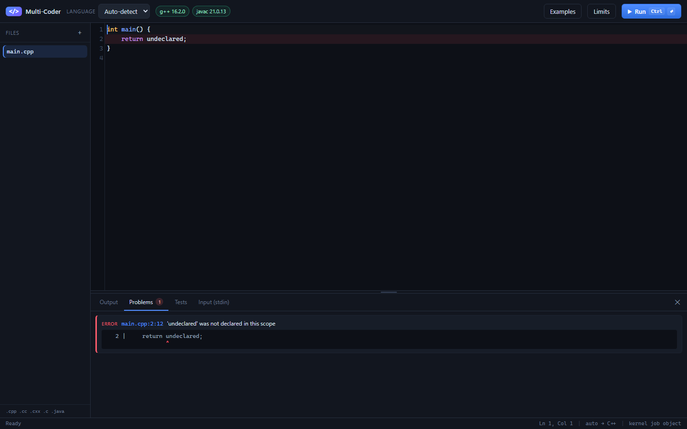

# Multi-Coder

A local, browser-based IDE that compiles and runs **C++**, **C** and **Java** side by side.
Drop code in, press <kbd>Ctrl</kbd>+<kbd>Enter</kbd>, get output — with real compilers, real
process limits, and compile errors turned into clickable diagnostics.

It is a thin, dependency-free Node server wrapping your own `g++` / `gcc` / `javac`, plus a
single-page front-end. Nothing is sent to a third party and nothing needs admin rights.

```
  npm run setup      # toolchains + editor assets + native launcher (once)
  npm start          # http://127.0.0.1:7788
```


Compile errors become clickable, caret-annotated diagnostics:



---

## What it does

| | |
|---|---|
| **Languages** | C++17 (`g++`), C17 (`gcc`), Java 21 (`javac` + JVM) |
| **Auto-detect** | language is inferred from the file extensions; `.cpp .cc .cxx .c++ .c` / `.java` |
| **Multi-file** | many files per project; Java gets real multi-class compilation |
| **stdin** | a dedicated input tab, fed to the program |
| **Test cases** | input + expected output, run as a batch with an AC/WA/TLE/MLE/RE verdict per case |
| **Limits** | wall-clock timeout and memory cap, enforced per run |
| **Diagnostics** | compiler output parsed into `file:line:col`, severity, source line and caret |
| **Isolation** | every run happens in a throwaway directory with a fresh process tree |

Verdicts follow the usual competitive-programming vocabulary:

| Verdict | Meaning |
|---|---|
| `OK` | ran and exited 0 |
| `AC` | output matched the expected output |
| `WA` | ran fine, output differed |
| `TLE` | killed at the time limit |
| `MLE` | hit the memory limit |
| `RE` | non-zero exit, or a launcher failure |
| `CE` | did not compile |

---

## Getting the toolchains

`npm run setup` runs `scripts/bootstrap-toolchains.ps1`, which downloads self-contained
builds into `tools/` — no installer, no PATH edits, no UAC prompt:

* `tools/mingw64` — MinGW-w64 GCC (UCRT, POSIX threads) from winlibs
* `tools/jdk21` — Eclipse Temurin JDK 21 LTS

It then vendors the CodeMirror editor assets into `public/vendor/` and compiles
`native/bin/jobrunner.exe`, so one command leaves the app fully runnable.

Already have compilers? The server prefers, in order:

1. `MULTICODER_CXX` / `MULTICODER_JAVA_HOME` environment overrides
2. `tools/mingw64/bin/g++`, `tools/jdk21/bin/javac`
3. whatever is on `PATH`

If a toolchain is missing the header chip turns red and the API returns a clear error instead
of failing at compile time.

---

## How it works

```
server.js              HTTP + static files + a 2-slot run queue
src/executor.js        request validation, compile plan, run loop, verdicts
src/runner.js          process launch (job object, or spawn fallback)
src/diagnostics.js     g++/javac output  ->  structured diagnostics
src/toolchains.js      toolchain discovery + version probing
src/examples.js        starter programs
native/jobrunner.cs    Windows Job Object launcher (kernel limits)
public/                the IDE (index.html, styles.css, app.js)
```

### Isolation and limits

On Windows every run goes through `native/bin/jobrunner.exe`. It creates a **Job Object**, starts
the child inside it, and:

* caps committed memory with `JOB_OBJECT_LIMIT_PROCESS_MEMORY` (a kernel limit, not a poller),
* reports `PeakProcessMemoryUsed` for the status line,
* terminates the *entire* process tree when the job closes — so a runaway `fork`/`thread` storm
  cannot outlive the request.

If that helper is not built (non-Windows, or `csc.exe` unavailable) the server falls back to
`spawn` + a timeout that kills the tree with `taskkill /T /F`, and reports the reduced guarantees
in the status bar.

Memory semantics differ slightly per language, on purpose:

* **C/C++** — `limits.memoryMB` is a hard commit limit. Allocation failure surfaces as `MLE`
  (or `std::bad_alloc`).
* **Java** — the same number becomes `-Xmx` (heap cap), because a JVM needs metaspace and code
  cache beyond the heap. `OutOfMemoryError` is reported as `MLE`; a 4× job-object backstop
  catches anything that escapes the heap.

### Diagnostics

`g++` and `javac` are both parsed, including javac's indented `symbol:` / `location:` blocks and
linker errors. Sources are re-read to attach the offending line, and the UI renders the caret at
the reported column. Clicking a diagnostic opens the file and jumps to the line.

Forcing an English locale (`LANG=C`, `-J-Duser.language=en`) keeps the parsers stable regardless
of the machine's language.

---

## HTTP API

`POST /api/run`

```jsonc
{
  "language": "auto",                 // "auto" | "cpp" | "c" | "java"
  "files": [{ "name": "Main.java", "content": "..." }],
  "stdin": "42\n",
  "limits": { "timeMs": 5000, "memoryMB": 256 },
  "tests": [{ "input": "2 3\n", "expected": "5\n" }]   // optional
}
```

Response:

```jsonc
{
  "ok": true,
  "language": "java",
  "limits": { "timeMs": 5000, "memoryMB": 256, "compileTimeMs": 60000 },
  "compile": {
    "ok": true, "ms": 940, "raw": "...",
    "errors": 0, "warnings": 1,
    "diagnostics": [{ "file": "Main.java", "line": 7, "col": 0, "severity": "warning",
                      "message": "...", "source": "...", "details": [] }]
  },
  "run": { "verdict": "OK", "exitCode": 0, "ms": 210, "peakMemoryBytes": 41234432,
           "stdout": "Hello\n", "stderr": "", "timedOut": false, "memoryExceeded": false },
  "tests": [], "testsSummary": null,
  "meta": { "mainClass": "Main", "durationMs": 1200 }
}
```

`GET /api/health` — toolchain versions, launcher mode, platform.
`GET /api/examples` — the starter programs.

---

## Shortcuts

| Key | Action |
|---|---|
| <kbd>Ctrl</kbd>+<kbd>Enter</kbd> | compile & run |
| <kbd>Ctrl</kbd>+<kbd>Shift</kbd>+<kbd>Enter</kbd> | run the test cases |
| <kbd>Ctrl</kbd>+<kbd>S</kbd> | persist to localStorage (also automatic) |
| <kbd>Esc</kbd> | close popovers |

Your files, limits, tests and stdin are kept in `localStorage`, so a refresh does not lose work.

---

## Notes and limits of the design

* **No interactive stdin.** Input is provided up front as text, exactly like an online judge.
  Programs that require a live TTY will behave differently.
* **One run at a time per tab**, two globally (`MAX_CONCURRENT_RUNS` in `server.js`).
* **It executes untrusted code** on your machine. The job object contains the process tree, but
  this is a development tool, not a security boundary — do not expose it to a network you do not
  control. It binds `127.0.0.1` by default for that reason.
* **Compile timeouts** are fixed at 60 s; template-heavy C++ still compiles well under that.
* Artifacts live in `.build/<runId>/` and are deleted after each request
  (`?keep=1` on the run endpoint keeps them for debugging).

## Adding a language

Add an entry to `src/executor.js` (a `plan()` returning the compile command and a run command)
and the matching extension in `EXT`. Everything else — diagnostics, limits, tests, UI — is
language-agnostic.
