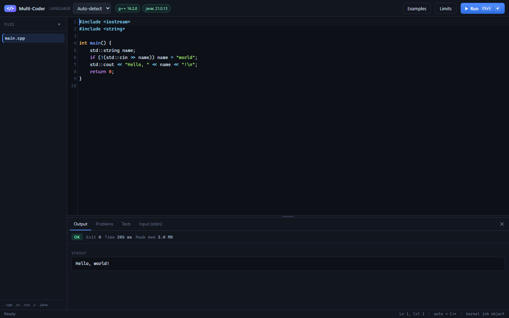
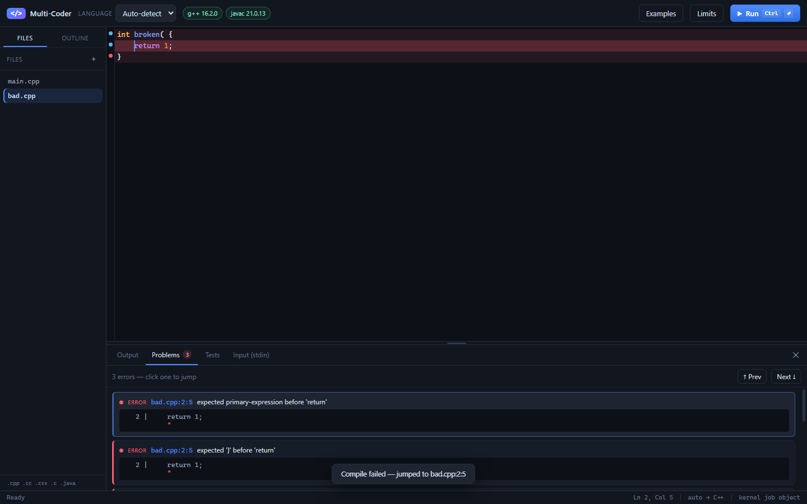
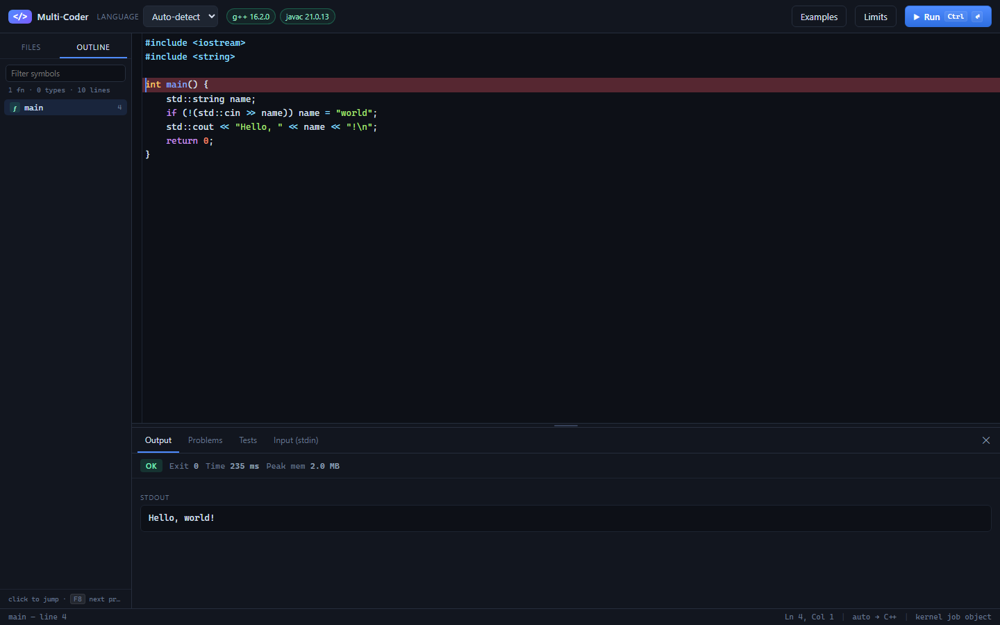
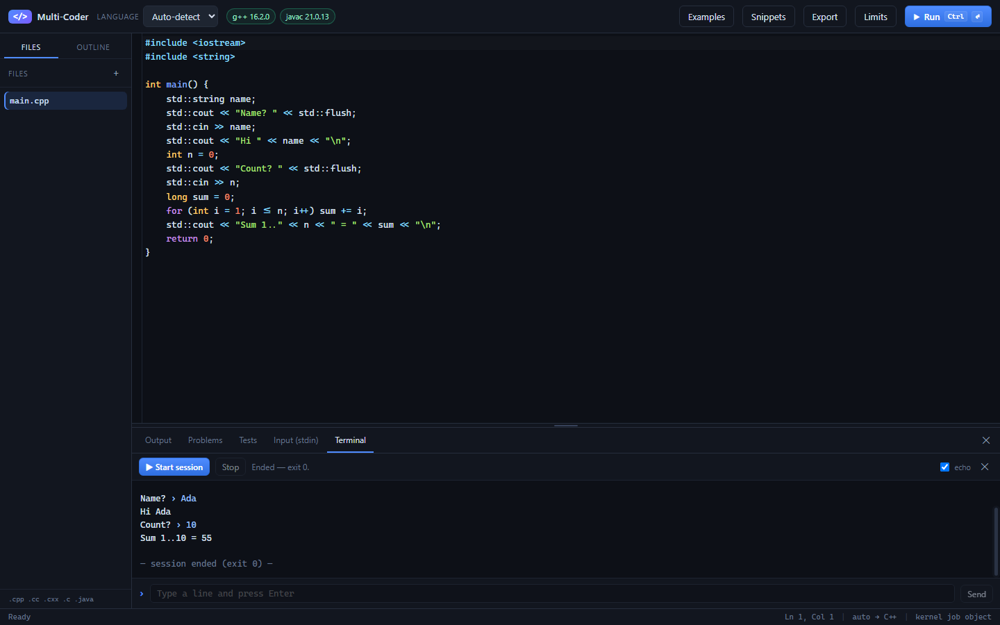
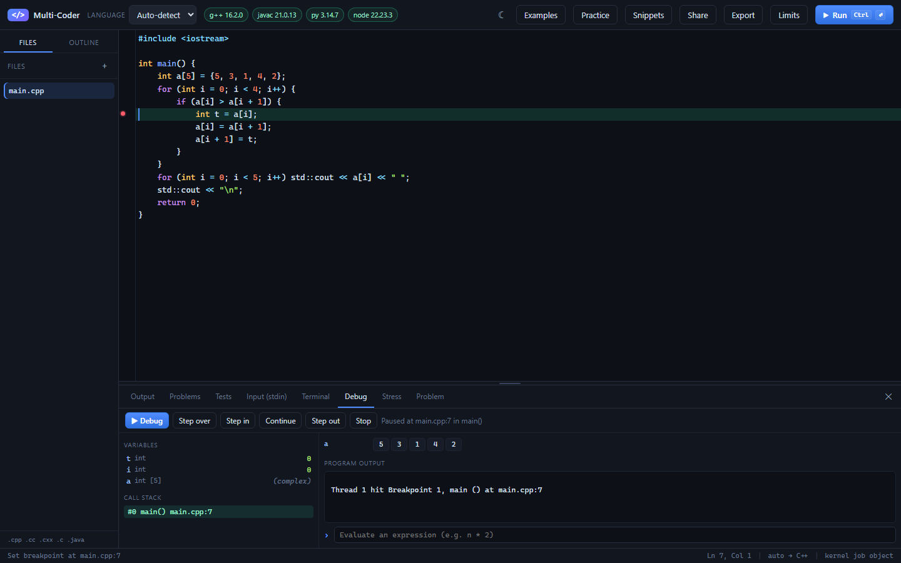

# Multi-Coder

A local, browser-based IDE that compiles and runs **C++**, **C** and **Java** side by side.
Drop code in, press <kbd>Ctrl</kbd>+<kbd>Enter</kbd>, get output — with real compilers, real
process limits, and compile errors turned into clickable diagnostics.

It is a thin, dependency-free Node server wrapping your own `g++` / `gcc` / `javac`, plus a
single-page front-end. Nothing is sent to a third party and nothing needs admin rights.

```
  npm run setup      # toolchains + editor assets + native launcher (once)
  npm start          # http://127.0.0.1:7788
```



Compile errors become clickable, caret-annotated diagnostics — and a failed build
takes you straight to the offending line:



The outline tab lists every class, method and free function in the current file:



Programs that prompt for input get a real conversation in the Terminal tab:



---

## What it does

| | |
|---|---|
| **Languages** | C++17 (`g++`), C17 (`gcc`), Java 21 (`javac` + JVM), Python 3 (`python`), JavaScript (`node`) |
| **Auto-detect** | language is inferred from the file extensions; `.cpp .cc .cxx .c++ .c .java .py .js .mjs` |
| **Multi-file** | many files per project; Java gets real multi-class compilation |
| **stdin** | a dedicated input tab, fed to the program |
| **Terminal** | interactive sessions: the program stays alive, you type and see replies live |
| **Outline** | live list of classes, methods and free functions — click to jump, filter as you type |
| **Test cases** | input + expected output, run as a batch with an AC/WA/TLE/MLE/RE verdict per case |
| **Limits** | wall-clock timeout and memory cap, enforced per run |
| **Diagnostics** | compiler output parsed into `file:line:col`, severity, source line and caret |
| **Error navigation** | a failed build opens the offending file, jumps to the exact line and marks it |
| **Snippets** | save named programs locally, reload them later, survive a browser wipe |
| **Export** | one-file HTML report with the source and the last run, ready to share or print |
| **Practice** | bundled problems with statements, starter code, samples and hidden tests |
| **Stress testing** | generate random cases, compare against a reference, get the counterexample |
| **Debugger** | breakpoints, stepping, call stack, locals and expression evaluation (C/C++) |
| **Live sharing** | share a keyed link and edit the same file with other people in real time |
| **Visualizer** | while debugging, arrays, vectors, matrices and strings are drawn as cells that light up when they change |
| **PTY terminal** | the Terminal tab runs programs in a real pseudo console: echo, line editing, ANSI colour |
| **Themes** | dark and light, switchable from the header |
| **Build cache** | identical sources reuse the previous binary, so re-runs skip compilation |
| **Isolation** | every run happens in a throwaway directory with a fresh process tree |

Verdicts follow the usual competitive-programming vocabulary:

| Verdict | Meaning |
|---|---|
| `OK` | ran and exited 0 |
| `AC` | output matched the expected output |
| `WA` | ran fine, output differed |
| `TLE` | killed at the time limit |
| `MLE` | hit the memory limit |
| `RE` | non-zero exit, or a launcher failure |
| `CE` | did not compile |

---

## Getting the toolchains

`npm run setup` runs `scripts/bootstrap-toolchains.ps1`, which downloads self-contained
builds into `tools/` — no installer, no PATH edits, no UAC prompt:

* `tools/mingw64` — MinGW-w64 GCC (UCRT, POSIX threads) from winlibs
* `tools/jdk21` — Eclipse Temurin JDK 21 LTS

It then vendors the CodeMirror editor assets into `public/vendor/` and compiles
`native/bin/jobrunner.exe`, so one command leaves the app fully runnable.

Already have compilers? The server prefers, in order:

1. `MULTICODER_CXX` / `MULTICODER_JAVA_HOME` environment overrides
2. `tools/mingw64/bin/g++`, `tools/jdk21/bin/javac`
3. whatever is on `PATH`

If a toolchain is missing the header chip turns red and the API returns a clear error instead
of failing at compile time.

---

## How it works

```
server.js              HTTP + static files + a 2-slot run queue
src/executor.js        request validation, compile plan, run loop, verdicts
src/runner.js          process launch (job object, or spawn fallback)
src/diagnostics.js     g++/javac output  ->  structured diagnostics
src/toolchains.js      toolchain discovery + version probing
src/examples.js        starter programs
src/sessions.js        interactive sessions (SSE output, POST input)
src/snippets.js        saved-program library (.data/snippets.json)
src/export.js          standalone HTML report generator
native/jobrunner.cs    Windows Job Object launcher (kernel limits)
public/outline.js      class/function scanner for the Outline panel
public/                the IDE (index.html, styles.css, app.js)
tests/                 outline parser tests + end-to-end suite
```

### Terminal and PTY

The **Terminal** tab starts a *session*: the program keeps running with live pipes,
its output streams to the panel, and each line you type goes to its stdin.

With **PTY** ticked (the default on Windows) the program runs inside a real pseudo
console (`native/ptyhost.exe`, ConPTY), so it behaves exactly as it would in a
terminal window: the console echoes your typing, line editing works, and ANSI
colours are rendered as coloured spans rather than escape gibberish. Clear it to
fall back to plain pipes, which is what a non-Windows host uses.

Sessions are capped at 3 concurrent, expire after 3 minutes, and can be stopped
from the panel. They run under a tree-kill, so they honour the time limit but not
the kernel memory cap — use Run for resource-limited judging.

### Debugger and visualizer

The **Debug** tab drives gdb's machine interface: click the left gutter to set a
breakpoint, then Debug. Step over/in/out, continue, walk the call stack, inspect
locals and evaluate expressions (<kbd>F5</kbd>/<kbd>F10</kbd>/<kbd>F11</kbd>).



On every stop the **visualizer** draws arrays, `std::vector`s, 2-D matrices and
strings from the current frame as cells, and highlights the cells that changed since
the previous step — enough to watch a sort or a BFS frontier without adding a single
`cout`. gdb's own pretty-printers do the decoding; the server parses the printed
form and the client renders it.

Java debugging is not supported (see the limits below).

### Snippets and export

**Snippets** saves the whole working copy (files, stdin, tests, language, limits)
under a name, server-side in `.data/snippets.json` — so it survives clearing site
data and is easy to back up. **Export** renders a single self-contained HTML file
with the escaped source, the last runtime result and per-test verdicts; it prints
cleanly to PDF and needs no assets or network.

### Error navigation

When a compile fails the IDE picks the first diagnostic that has a location, opens
that file even if it is not the one being edited, places the cursor on the exact
line and column, flashes it, and drops a red dot in the gutter. Every diagnostic
gets a gutter marker and a line tint, so the whole failing region is visible at a
glance. <kbd>F8</kbd> and <kbd>Shift</kbd>+<kbd>F8</kbd> walk the list; the
Problems toolbar shows the current position.

### Outline

`public/outline.js` is a small heuristic scanner: it blanks out comments and string
literals, tracks brace depth, then recognises `class`/`struct`/`enum`/`interface`/
`record` declarations and function definitions (including constructors, multi-line
parameter lists and out-of-class `Foo::bar` definitions). It is language-agnostic
across C, C++ and Java, runs on every keystroke (debounced), and never throws on
malformed input. Symbols whose line has a diagnostic are tinted red.

### Compile cache

Every build is keyed by a hash of the sources, the detected language and the
compiler version. A hit copies the previous artifact into the run directory instead
of invoking `g++`/`javac`, which turns a repeat run from ~1.7 s into ~0.3 s. Entries
live in `.cache/builds/`, are pruned to the 80 most recent, and a failed compile is
never cached. Bump `FLAGS_VERSION` in `src/executor.js` when the compile flags change.

### Live sharing

Press **Share** and a link like
`http://127.0.0.1:7788/#room=AbC123&key=…` is copied. Opening it in another browser
joins the room: both editors hold the same file and edits appear on both sides as
you type. The bar above the editor lists who is connected.

The `key` is a per-room secret; every read and write (stream, operations, snapshot)
is rejected with `401` without it, and the room listing never exposes it. The key
travels in the URL fragment, so it is not sent in a request path or written to a
server log. Anyone with the link can edit — for anything beyond a trusted network,
put TLS and an authenticating proxy in front.

Synchronisation is **operational transformation** for single-splice edits:

1. a local edit becomes `{ pos, del, ins }`,
2. it is sent with the revision it was based on,
3. the server transforms it against everything applied since, applies the result,
   and broadcasts the transformed op over SSE,
4. clients apply remote ops immediately, and ask for a fresh snapshot if they fall
   behind.

Each client applies its own keystroke locally first, so typing never waits on the
network. When a client cannot be transformed cleanly - a stale revision, or remote
edits arriving while its own are still queued - it resyncs from the server's
canonical document instead of guessing. That trades a rare visual jump for
guaranteed convergence in a 2-5 person room.

Rooms live in memory and expire after an hour of inactivity.

### Themes

The header's sun/moon button switches between the dark palette and a light one;
colours come from CSS variables so every panel, the terminal, the debugger and the
editor's syntax highlighting follow along.

### Isolation and limits

On Windows every run goes through `native/bin/jobrunner.exe`. It creates a **Job Object**, starts
the child inside it, and:

* caps committed memory with `JOB_OBJECT_LIMIT_PROCESS_MEMORY` (a kernel limit, not a poller),
* reports `PeakProcessMemoryUsed` for the status line,
* terminates the *entire* process tree when the job closes — so a runaway `fork`/`thread` storm
  cannot outlive the request.

If that helper is not built (non-Windows, or `csc.exe` unavailable) the server falls back to
`spawn` + a timeout that kills the tree with `taskkill /T /F`, and reports the reduced guarantees
in the status bar.

Memory semantics differ slightly per language, on purpose:

* **C/C++** — `limits.memoryMB` is a hard commit limit. Allocation failure surfaces as `MLE`
  (or `std::bad_alloc`).
* **Java** — the same number becomes `-Xmx` (heap cap), because a JVM needs metaspace and code
  cache beyond the heap. `OutOfMemoryError` is reported as `MLE`; a 4× job-object backstop
  catches anything that escapes the heap.

### Diagnostics

`g++` and `javac` are both parsed, including javac's indented `symbol:` / `location:` blocks and
linker errors. Sources are re-read to attach the offending line, and the UI renders the caret at
the reported column. Clicking a diagnostic opens the file and jumps to the line.

Forcing an English locale (`LANG=C`, `-J-Duser.language=en`) keeps the parsers stable regardless
of the machine's language.

---

## HTTP API

`POST /api/run`

```jsonc
{
  "language": "auto",                 // "auto" | "cpp" | "c" | "java"
  "files": [{ "name": "Main.java", "content": "..." }],
  "stdin": "42\n",
  "limits": { "timeMs": 5000, "memoryMB": 256 },
  "tests": [{ "input": "2 3\n", "expected": "5\n" }]   // optional
}
```

Response:

```jsonc
{
  "ok": true,
  "language": "java",
  "limits": { "timeMs": 5000, "memoryMB": 256, "compileTimeMs": 60000 },
  "compile": {
    "ok": true, "ms": 940, "raw": "...",
    "errors": 0, "warnings": 1,
    "diagnostics": [{ "file": "Main.java", "line": 7, "col": 0, "severity": "warning",
                      "message": "...", "source": "...", "details": [] }]
  },
  "run": { "verdict": "OK", "exitCode": 0, "ms": 210, "peakMemoryBytes": 41234432,
           "stdout": "Hello\n", "stderr": "", "timedOut": false, "memoryExceeded": false },
  "tests": [], "testsSummary": null,
  "meta": { "mainClass": "Main", "durationMs": 1200 }
}
```

`GET /api/health` — toolchain versions, launcher mode, cache stats, live sessions.
`GET /api/examples` — the starter programs.

Interactive sessions:

| Endpoint | Purpose |
|---|---|
| `POST /api/session/start` | compile and start the program with live pipes; returns a session id |
| `GET /api/session/:id/stream` | SSE stream of `{t:"o"｜"e",d}` output chunks and a final `{t:"x",code}` |
| `POST /api/session/:id/input` | `{ "data": "..." }` written straight to the program's stdin |
| `POST /api/session/:id/stop` | terminate the process tree |

Snippets:

| Endpoint | Purpose |
|---|---|
| `GET /api/snippets` | summaries (name, files, lines, timestamps) |
| `POST /api/snippets` | save `{ name, files, stdin, tests, language, limits }` |
| `GET /api/snippets/:id` | full snippet, ready to load |
| `PUT /api/snippets/:id` | rename or overwrite |
| `DELETE /api/snippets/:id` | remove |

Export: `POST /api/export` with `{ title, language, files, result, notes }` returns a
complete HTML document (`text/html`).

---

## Shortcuts

| Key | Action |
|---|---|
| <kbd>Ctrl</kbd>+<kbd>Enter</kbd> | compile & run |
| <kbd>Ctrl</kbd>+<kbd>Shift</kbd>+<kbd>Enter</kbd> | run the test cases |
| <kbd>F8</kbd> / <kbd>Shift</kbd>+<kbd>F8</kbd> | next / previous problem |
| <kbd>Ctrl</kbd>+<kbd>S</kbd> | persist to localStorage (also automatic) |
| <kbd>Esc</kbd> | close popovers |

Your files, limits, tests and stdin are kept in `localStorage`, so a refresh does not lose work.

---

## Tests

```bash
npm test
```

| Suite | Covers |
|---|---|
| `tests/outline.js` | the class/function scanner across C, C++ and Java — nesting, comments, multi-line signatures, lambdas, malformed input |
| `tests/problems.mjs` | every stored expected output in the practice set, checked against an independent solver |
| `tests/languages.mjs` | Python and JavaScript: run, syntax errors, tracebacks, TLE, tests, mixed-language rejection |
| `tests/stress.mjs` | generator/reference comparison, counterexample capture, compile failures, Python stress |
| `tests/smoke.js` | end-to-end against the real compilers: run, AC/WA/CE, TLE, MLE, Java multi-class and `OutOfMemoryError`, path-traversal rejection |
| `tests/debugger.mjs` | gdb MI: breakpoints, stepping, frames, locals, expression evaluation, clean exit, Java refusal |
| `tests/collab.mjs` | operational transform: concurrent inserts, deletes, stale-revision resync, SSE relay (auto-skips when no server is running) |

The suites need `npm run setup` first; `tests/collab.mjs` additionally needs `npm start`
running on the default port (or set `MULTICODER_URL`).

## Notes and limits of the design

* **Batch stdin vs live sessions.** The Input tab feeds stdin up front, exactly like an
  online judge; the Terminal tab is the interactive path for programs that prompt.
* **The debugger is C/C++ only.** Java goes through `Run`; `jdb`/JDWP is a different
  protocol and is deliberately out of scope.
* **Collaboration is a few-person tool.** Rooms are in memory, unauthenticated, and
  bound to whatever address the host serves on. Put authentication and TLS in front of
  it before letting anyone outside your network connect.
* **One run at a time per tab**, two globally (`MAX_CONCURRENT_RUNS` in `server.js`).
* **It executes untrusted code** on your machine. The job object contains the process tree, but
  this is a development tool, not a security boundary — do not expose it to a network you do not
  control. It binds `127.0.0.1` by default for that reason.
* **Compile timeouts** are fixed at 60 s; template-heavy C++ still compiles well under that.
* Artifacts live in `.build/<runId>/` and are deleted after each request
  (`?keep=1` on the run endpoint keeps them for debugging).

## Adding a language

Add an entry to `src/executor.js` (a `plan()` returning the compile command and a run command)
and the matching extension in `EXT`. Everything else — diagnostics, limits, tests, UI — is
language-agnostic.
